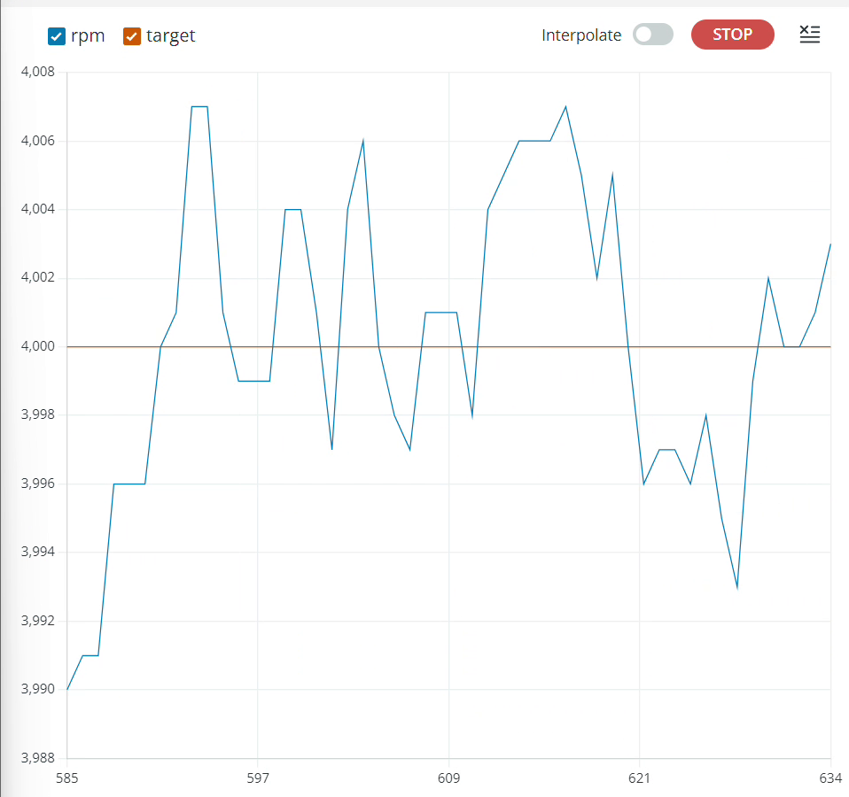
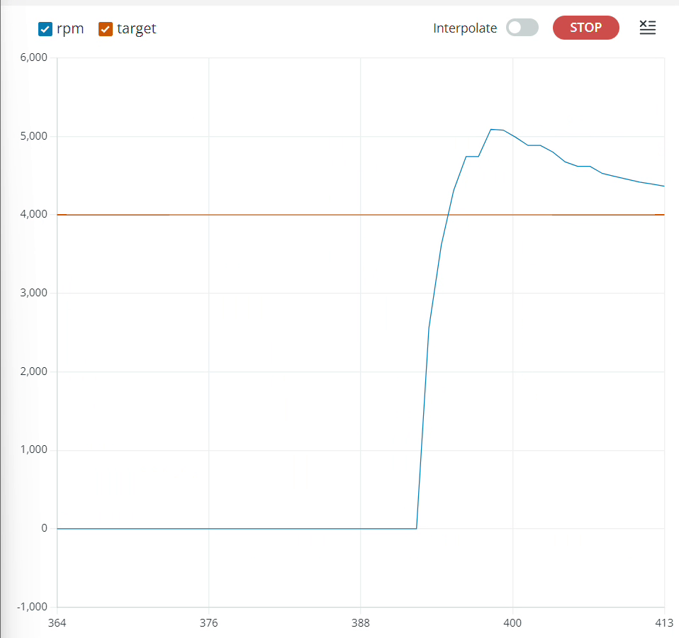
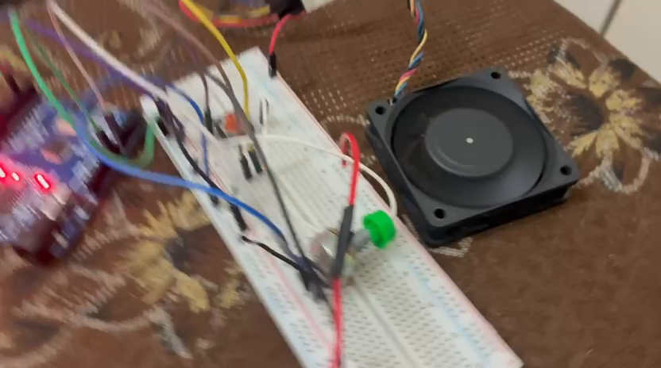

# HackerFab NITW

We're a group of second-year EEE students at NIT Warangal trying to build a small photolithography setup in our hostel. We're following the [HackerFab](https://docs.hackerfab.org/home) guide, and the HackerFab community at IIT Bombay has been helping us along the way.

For our first round, the plan is to build a spin coater out of a PC fan, then do one complete lithography run on a glass slide: coat it with resin, expose a pattern, and develop it. After that we'll repeat it on a small piece of silicon. Things like oxide growth, etching, doping and metal layers come later, and we haven't started on them.

## Where we are right now (November 2026)

| Phase | Status |
|---|---|
| A: Buying parts | Mostly done. We have the fan, the Arduino Nano, a 12 V supply, the control electronics and the glass slides. We're holding off on resin, IPA and the UV torch for now (the roadmap explains why). |
| B: Testing the fan by itself | Done |
| C: Wiring the control circuit | Done on a breadboard. We'll move it to a perfboard next. |
| D: Closed-loop speed control | Working on the bare fan. The final tuning has to wait until the chuck is mounted, because that changes the load. |
| E: Mounting (baseplate, chuck disc) | This is next. We have the parts. |
| F to H: Dry run, slide prep, first coat | Not started |
| I to K: Mask, exposure, developing | We've designed the test mask (in [`mask/`](mask/)). Exposures need a coated slide first. |

We set ourselves four things that have to be done before we call this round finished. None of them are done yet. The closest is the first one, a logged and repeatable spin profile.

## What we have working: speed control

The Arduino reads the fan's tachometer, works out how fast it's spinning, and keeps adjusting the PWM signal to hold whatever speed we set.

This is the controller holding a 4,000 RPM target. Once it settles, the reading stays between roughly 3,990 and 4,008 RPM. The target we'd set for ourselves was to stay within 1%.

This is what happens when it starts from rest. It overshoots to around 5,100 RPM and takes a few seconds to come back down to the target. That's what we're fixing next, since the resin needs a smooth ramp-up to spread evenly.

We recorded this on 6 November 2026, with the fan blades still attached and no chuck mounted.

Videos:
- [`closed-loop-4000rpm-screen.mp4`](media/closed-loop-4000rpm-screen.mp4): the code and the live speed graph, from start-up until it settles
- [`bench-setup-running.mp4`](media/bench-setup-running.mp4): the setup on the table while it runs
- [`bench-start-stop.mp4`](media/bench-start-stop.mp4): starting and stopping with the button

## What's in this repo

| Path | What it is |
|---|---|
| [`docs/what-our-first-plan-got-wrong.md`](docs/what-our-first-plan-got-wrong.md) | All the places where our original plan didn't match the real parts, and what we changed |
| [`docs/roadmap.md`](docs/roadmap.md) | What we're planning to do until April 2027 |
| `docs/build-guide-rev2.pdf` | The full build guide we use as a team |
| [`firmware/`](firmware/) | The spin coater controller code |
| [`mask/HF-NITW_mask_v1.pdf`](mask/HF-NITW_mask_v1.pdf) | Our test mask, with a resolution ladder (50 to 1500 µm lines and gaps) and an 8-step exposure ladder |
| [`media/`](media/) | Graphs, photos and videos |

## Team

- Venu Gopal Dash: coordinating the team, the build guide, and checking parts and specs
- Arjan Singh Aujla: controller code
- [name]: lithography prep (mask, exposure setup, developing station)
